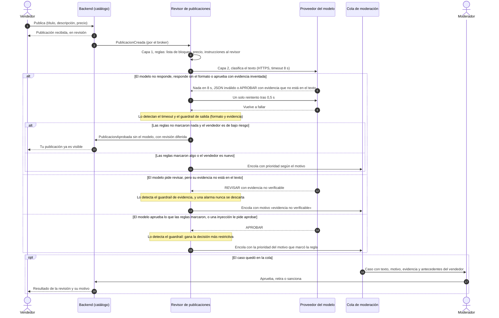

# ADR-002: Las publicaciones nuevas pasan por reglas y un modelo de lenguaje antes de mostrarse; solo un moderador retira o sanciona

Estado: propuesto
Proyecto: Marketplace de segunda mano · Grupo 8
Escenarios relacionados: QA-1 (una publicación nueva aparece en ≤ 30 s), QA-2 (costo por usuario) y la restricción del caso sobre el equipo de moderación

## Contexto y fuerzas

El caso dice que el spam y las estafas «llegan solos» y que la moderación es parte del negocio (RF-06). Hoy la cola de moderación solo se alimenta de reportes: cuando uno llega, algún comprador ya vio la publicación y quizás ya escribió o pagó. La pregunta abierta del caso es qué señales alimentan la cola y cómo se prioriza con un equipo pequeño. Este ADR decide si un modelo de lenguaje ayuda a responderla, y dónde.

- **Antifraude como requisito, no como eje de arbitraje.** El ADR-000 (D3) dice que el antifraude es «requisito y trabajo de producto, no eje de arbitraje en esta fase». Este ADR lo respeta: el revisor es un requisito, y se arbitra con QA-1 (no pasar de 30 s para aparecer) y con QA-2 (el techo de costo), sin volverlo un atributo rector.
- **Gravedad del error, asimétrica.** Un falso negativo deja visible una estafa o un artículo prohibido, y en una plataforma donde dos desconocidos quedan de verse la confianza es el producto (ADR-000). Un falso positivo retiene una publicación legítima hasta que un moderador la mira: molesta, pero se corrige. Por eso el error caro lo decide una persona, y el modelo nunca puede retirar ni sancionar.
- **Tiempo.** QA-1 (M2) promete que una publicación nueva aparece en ≤ 30 s (p95). La revisión automática tiene que caber en ese presupuesto.
- **Volumen.** El entorno de QA-1 fija 300 altas o modificaciones por hora en el pico. Como cota superior: 300 × 24 h × 30 días = 216.000 revisiones al mes.
- **Costo.** La plataforma es gratuita, y QA-2 pone el gasto de imágenes en unos USD 1.000 al mes (500.000 usuarios activos × USD 0,002). Supuesto del equipo: la moderación automática no puede costar más del 20 % de eso, USD 200 al mes, o sea ≤ USD 0,00092 por revisión en la cota superior. En tokens: unos 700 de entrada (instrucciones más 1.000 caracteres de texto) y unos 60 de salida (el JSON) por revisión, así que cabe cualquier modelo cuyo precio combinado sea ≤ ≈ USD 1,2 por millón de tokens (0,00092 ÷ 760). Los dos tamaños son supuestos del equipo.
- **Capacidad humana.** Supuesto del equipo, a validar: 2 moderadores por turno con unos 40 casos por hora cada uno (90 s por caso), 80 casos/h. Si los reportes ocupan unos 20/h, quedan 60/h para la revisión previa: con 300 altas/h, a lo sumo el 20 % puede ir a una persona.
- **Datos.** El modelo recibe solo el texto público de la publicación, nunca las conversaciones, que el caso declara privadas. Teléfonos, correos y enlaces se enmascaran antes de enviar, porque el proveedor es un tercero (Ley 1581 de 2012).
- **¿Cabe en un `if`?** En parte. Una regla resuelve la lista de bloqueo que ya gestiona el moderador, un contacto externo, un precio muy por debajo de su categoría o un texto que le da instrucciones al revisor. No resuelve la paráfrasis («celu de remate, no pregunte procedencia»), la ortografía alterada a propósito, los eufemismos («réplica AAA») ni el patrón de estafa por pago anticipado. Esa parte es la que justificaría un modelo.

## Decisión

Toda publicación nueva (`PublicacionCreada`), o con título, descripción o precio editados (`PublicacionEditada`), pasa por un **revisor de publicaciones** (worker del monolito) antes de entrar al índice. **Solo lo aprobado entra al índice:** el revisor (o el moderador) publica `PublicacionAprobada`, que es lo único que consume el indexador, también cuando la publicación sale sin el modelo. Combina los patrones **guardrails** y **human-in-the-loop** en cuatro capas:

1. **Reglas.** Marcan una palabra de la lista de bloqueo, un precio por debajo del 20 % de la mediana de su categoría o un texto que le da instrucciones al revisor. El contacto externo se oculta en la publicación (la negociación va por el chat) y además **marca**: la publicación va a la cola con el motivo «contacto externo», en la prioridad más baja. Un cambio de precio solo pasa por esta capa y, si no marca, se publica como `PublicacionAprobada` con el precio nuevo.
2. **Modelo de lenguaje.** Recibe título, descripción (máximo 1.000 caracteres), categoría, precio y zona, y responde un JSON con `decision` (`APROBAR` o `REVISAR`), `motivo` (lista cerrada: prohibido, estafa, precio, ninguno) y `evidencia` (el fragmento literal que lo justifica). Timeout de 8 s y un solo reintento tras 0,5 s. No tiene herramientas ni permisos: su respuesta es un dato que el código valida.
3. **Guardrail de salida.** Rechaza el JSON que no cumple el formato, descarta un `APROBAR` cuya evidencia no aparece en el texto. **Un `REVISAR` nunca se descarta:** si su evidencia no está en el texto, va a la cola con el motivo «evidencia no verificable», porque una alarma mal justificada no puede convertirse en una publicación sin revisar. También y aplica «gana la decisión más restrictiva»: si las reglas marcaron algo, el `APROBAR` del modelo no cuenta.
4. **Moderador.** Todo `REVISAR` entra a la cola con prioridad: prohibido, luego estafa, luego evidencia no verificable, luego precio, luego contacto externo, ajustada por la reputación del vendedor y sus reportes previos. Solo el moderador aprueba, retira o sanciona: si aprueba, el backend publica `PublicacionAprobada`; si retira, publica `PublicacionRetirada` y el indexador la saca del índice (también lo que entró por la revisión diferida, el muestreo o un reporte).

Si el modelo no da una respuesta válida (no responde, el JSON no cumple el formato o aprueba con una evidencia que no está en el texto), el revisor sigue sin él: si las reglas no marcaron nada y el vendedor es de bajo riesgo (cuenta de más de 30 días y al menos una venta), la publicación sale y queda en **revisión diferida**, que se repite cuando el proveedor vuelve; si no, va a la cola. Además, el 2 % de las publicaciones aprobadas automáticamente va a la cola con prioridad baja, para medir los errores que nadie reporta. Cada decisión deja una traza: publicación, versión de las instrucciones y del modelo, respuesta del modelo, decisión final y tiempo.

## Alternativas descartadas

| Alternativa                                              | Qué ganábamos                                                                                                       | Por qué la descartamos                                                                                                                                                                                                                                                                                                                                                                                            |
| -------------------------------------------------------- | --------------------------------------------------------------------------------------------------------------------- | ------------------------------------------------------------------------------------------------------------------------------------------------------------------------------------------------------------------------------------------------------------------------------------------------------------------------------------------------------------------------------------------------------------------ |
| **Sin modelo de lenguaje: solo reglas y reportes** | Costo cero por revisión, comportamiento determinista, ningún proveedor externo ni datos que salgan de la plataforma | Las reglas solo ven lo que alguien ya escribió en la lista: la paráfrasis y la ortografía alterada pasan, y la estafa se detecta por reportes, cuando un comprador ya quedó expuesto. Mantener a mano una lista que los estafadores esquivan en días no escala con un equipo pequeño. Las reglas se quedan como primera capa, y el modelo tiene que ganarles en el conjunto de evaluación; si no, se retira |
| Revisión humana de todas las publicaciones              | La mayor precisión posible                                                                                           | 300 altas/h contra unos 60 casos/h de capacidad: la cola crecería unas 240 por hora, justo lo que el caso prohíbe («priorizar, no acumular»), y ninguna publicación cumpliría los 30 s de QA-1                                                                                                                                                                                                               |
| El modelo decide solo, sin persona                       | Cero carga para los moderadores                                                                                       | Retirar o sancionar por un error del modelo es caro y difícil de revertir para el vendedor, y una inyección en la descripción podría dirigir esa acción                                                                                                                                                                                                                                                       |
| Modelo que revisa texto y fotos                          | Detecta lo que solo se ve en la imagen                                                                                | Con 3 a 10 fotos por publicación, el costo de cada revisión se multiplica y rompe el techo de USD 0,00092. Se revisa cuando llegue la monetización o si los reportes muestran fraudes que solo se ven en la foto                                                                                                                                                                                                |
| Clasificador propio entrenado                            | Menor costo por consulta                                                                                              | En el primer año no hay datos etiquetados. Las decisiones de los moderadores en la cola los van a producir; se reevalúa en seis meses                                                                                                                                                                                                                                                                            |

## Modo de falla y control

El modelo puede fallar de forma visible (no responde o responde sin el formato) o silenciosa (inventa la evidencia, o aprueba lo que no debía, por error o por una inyección escrita en la descripción). El diagrama muestra el camino de la falla, qué la detecta y cómo termina cada rama.

Lo que este control no detecta: si el modelo aprueba y las reglas no ven nada (por ejemplo, una inyección que esquiva la regla), la publicación sale. El daño queda acotado porque el modelo no tiene permisos: el peor caso es el mismo de hoy sin modelo, y lo detectan después el muestreo del 2 % y los reportes.

## Cómo se mide que funciona

**Conjunto de evaluación.** 60 publicaciones escritas por el equipo a partir de patrones de cada categoría del caso (muebles, tecnología, bicicletas, ropa): 40 legítimas, 10 de ellas difíciles a propósito (precio bajo por un daño declarado, pero por encima del umbral de la regla de precio; palabras parecidas a las prohibidas en un contexto legal), y 20 problemáticas: 6 artículos prohibidos, 8 estafas o señales de robo, 2 con contacto externo y 4 con instrucciones inyectadas en la descripción. Dos integrantes etiquetan cada caso por separado con la lista escrita de prohibidos y señales de estafa; si no coinciden, decide un tercero.

| Medida                                               | Umbral              | De dónde sale                                                                                                                                                                                                                                                                                                                                |
| ---------------------------------------------------- | ------------------- | --------------------------------------------------------------------------------------------------------------------------------------------------------------------------------------------------------------------------------------------------------------------------------------------------------------------------------------------- |
| Problemáticas aprobadas sin persona                 | 0 de 20             | Una estafa visible no se compensa: el comprador ya quedó expuesto. Es el «0 daños» del ejemplo de clase                                                                                                                                                                                                                                   |
| Legítimas enviadas a revisión                      | ≤ 4 de 40 (10 %)   | La capacidad de la cola: con 60 casos/h y 300 altas/h, un 10 % de falsos positivos más los positivos reales (supuesto: 5 %) suman unos 44 casos/h, y el muestreo del 2 % de lo aprobado otros 5/h: unos 49; el contacto externo, que también va a la cola, suma poco porque la negociación va por el chat (supuesto a medir el primer mes) |
| Problemáticas que detecta el modelo y no las reglas | ≥ 6 de 20          | Es lo que justifica pagar el modelo: si las reglas solas ya las detectan, el modelo sobra y este ADR se revisa                                                                                                                                                                                                                                |
| Misma decisión al repetir el caso                   | ≥ 9 de 10 corridas | El modelo no es determinista; una decisión que cambia al repetir no sirve para moderar                                                                                                                                                                                                                                                       |
| Costo por revisión                                  | ≤ USD 0,00092      | El techo derivado de QA-2 (USD 200 al mes en la cota superior)                                                                                                                                                                                                                                                                                |

El conjunto se corre antes de activar el revisor y cada vez que cambien las instrucciones, el modelo o el proveedor, que puede actualizar el modelo sin avisar. Cada mes se suman 10 casos nuevos tomados de las decisiones de los moderadores.

## Consecuencias

**Lo que mejora**

- La cola recibe señales antes de que un comprador quede expuesto, con un motivo y una evidencia que el moderador verifica en segundos: prioriza en lugar de acumular.
- Las decisiones de los moderadores se vuelven casos etiquetados, primero para el conjunto de evaluación y después para un clasificador propio.

**Lo que empeora, y aceptamos**

- **Costo nuevo y un proveedor más:** hasta USD 200 al mes en la cota superior, y un tercero que puede cambiar el modelo sin avisar; por eso el conjunto de evaluación se vuelve a correr.
- **Latencia:** en el peor caso (timeout, reintento y otro timeout) el revisor tarda 16,5 s, todavía dentro de los 30 s de QA-1. Las publicaciones que van a la cola no cumplen esos 30 s: QA-1 (M2) pasa a aplicar a las aprobadas automáticamente, y las de la cola necesitan su propia meta (propuesta: revisadas en ≤ 4 h dentro del horario de moderación). Es la revisión del ADR-000 que él mismo previó «con la llegada del primer requisito nuevo».
- **Falsos positivos:** hasta el 10 % de las publicaciones legítimas espera a un moderador, más las que traen un contacto externo o un precio por debajo de la regla, y el vendedor ve «en revisión».
- **Degradación con riesgo:** si el proveedor del modelo cae, las publicaciones de bajo riesgo salen solo con reglas, y durante la caída puede colarse algo que el modelo habría marcado; la revisión diferida lo recoge cuando el proveedor vuelve.
- **Datos personales:** el texto viaja a un tercero. Se enmascaran los contactos, se necesita un acuerdo de tratamiento de datos con el proveedor (Ley 1581 de 2012) y las trazas guardan solo lo necesario, con retención limitada.
- **Amplía la frontera del ADR-000 (D5),** que admite un solo sistema externo: el proveedor del modelo es el segundo, como pide el enunciado. El ADR-000 se revisa, como él mismo prevé con el primer requisito nuevo.
- **Una pieza más en la vista:** el revisor de publicaciones y el proveedor del modelo como sistema externo, con «HTTPS, síncrono, timeout 8 s».
