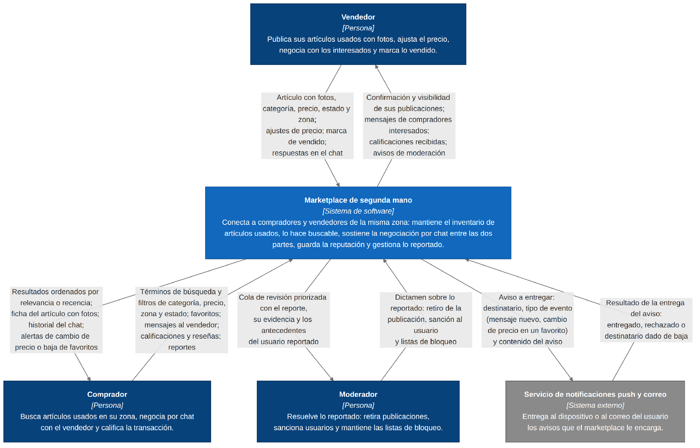

# Cuestionario 1 · La visión del sistema

Marketplace de segunda mano · Grupo 8 · Arquitectura de Software, UFPS

## Pregunta 1. Actores y sus intercambios

Aplicamos un solo criterio para admitir un actor: si no intercambia información con el sistema, no es actor. Los cuatro que quedan intercambian en los dos sentidos.

**Tabla 1.** Actores del sistema y la información que intercambian

| Actor | Tipo | Qué entrega al sistema | Qué recibe del sistema |
|---|---|---|---|
| Vendedor | Persona | Artículo con fotos, categoría, precio, estado y zona; ajustes de precio; marca de vendido; respuestas en el chat; réplica a un reporte. | Confirmación de la publicación y su visibilidad en los resultados; mensajes de compradores interesados; calificaciones y reseñas; avisos de moderación sobre sus publicaciones o su cuenta. |
| Comprador | Persona | Términos de búsqueda y filtros de categoría, precio, zona y estado; criterio de orden; marcado de favoritos; mensajes al vendedor; calificaciones y reseñas; reportes. | Resultados ordenados por relevancia o recencia, solo con publicaciones activas; ficha del artículo con fotos; historial completo de la conversación; alertas de cambio de precio o baja de un favorito; acuse del reporte. |
| Moderador | Persona | Dictamen sobre lo reportado: retiro o restitución de la publicación, sanción al usuario, entradas y salidas de las listas de bloqueo, con el motivo de cada decisión. | Cola de revisión priorizada con el reporte, su evidencia y los antecedentes del usuario reportado; efecto aplicado de cada dictamen. |
| Servicio de notificaciones push y correo | Sistema externo | Resultado de la entrega de cada aviso: entregado, rechazado, o destinatario dado de baja o con dispositivo inválido. | Aviso a entregar: destinatario, tipo de evento (mensaje nuevo, cambio de precio o baja de un favorito) y contenido del aviso. |

*Nota.* Elaboración propia a partir del caso asignado.

**Dos actores que evaluamos y dejamos fuera.** El equipo de soporte existe (la restricción de privacidad del caso lo nombra), pero accede a una conversación siempre con un reporte de por medio, es decir, por el mismo camino del moderador; en esta versión es una función de ese rol y no un actor propio. La pasarela de pagos no entra porque el caso no la tiene: la transacción se cierra entre personas y la monetización llega después.

## Pregunta 2. Funciones esenciales

La prueba que aplicamos es la del enunciado: si al quitar la función el sistema sigue teniendo sentido, no es esencial. Quedaron seis.

**Tabla 2.** Funciones esenciales del sistema

| # | Función | Para quién | Por qué es esencial |
|---|---|---|---|
| F1 | Publicar y mantener un artículo: alta con fotos, categoría, precio, estado y zona, y ajuste posterior del precio. | Vendedor | Sin publicación no hay inventario, y sin inventario no hay nada que buscar. |
| F2 | Buscar y filtrar el inventario activo, y ordenarlo por relevancia o recencia. | Comprador | Es la función por la que el comprador entra. Sin ella hay un depósito de artículos que nadie encuentra. |
| F3 | Conversar por chat sobre un artículo concreto, con historial persistente. | Comprador y vendedor | Es donde se cierra el trato. Sin ella la plataforma es un tablón de anuncios, no un marketplace. |
| F4 | Avisar al destinatario ausente de que tiene un mensaje nuevo. | Comprador y vendedor | Una negociación entre dos personas que rara vez están conectadas a la vez muere sin el aviso. Es lo que convierte el chat en un canal utilizable. |
| F5 | Marcar un artículo como vendido y retirarlo de los resultados. | Vendedor, y sobre todo comprador | Sin ella el inventario visible deja de ser cierto, y una búsqueda sobre inventario falso no vale nada. |
| F6 | Recibir reportes de publicaciones y usuarios, y resolverlos. | Moderador y toda la comunidad | El caso lo dice sin rodeos: la moderación es parte del negocio, no un accesorio. Sin ella la plataforma se llena de estafa y se vacía de usuarios. |

*Nota.* Elaboración propia a partir de los requisitos funcionales del caso.

**Lo que dejamos fuera y por qué.** Los favoritos con alerta de cambio de precio (RF-04) son una función de retención excelente, pero el sistema sigue teniendo sentido sin ellos. La reputación con calificaciones y reseñas (RF-05) nos costó más: es el mecanismo de confianza del producto. La dejamos fuera de la esencia porque un marketplace funciona sin reputación (muchos empezaron así) pero no funciona sin moderación: sin reputación hay menos confianza; sin moderación hay estafa. Es una decisión discutible y la registramos como tal.

## Pregunta 3. Diagrama de contexto

El diagrama de contexto corresponde al nivel 1 del modelo C4: el sistema como caja negra, los actores y sistemas externos alrededor y flechas etiquetadas con la información que fluye, sin tecnologías ni módulos internos.

*Nota.* Azul oscuro: personas. Azul: sistema en estudio. Gris: sistema externo. Cada par de actores tiene dos flechas, una por sentido, porque la información que entra no es la misma que sale. Elaboración propia.

**La decisión que tomamos al dibujarlo: qué quedó por fuera de la frontera.** Lo más difícil no fue decidir qué dibujar sino qué no. El índice de búsqueda y el almacenamiento y distribución de las fotos quedaron por fuera. Es lo que más discutimos, porque son las dos piezas que dominan el caso: el índice sostiene la búsqueda de menos de un segundo y las imágenes dominan el almacenamiento y el ancho de banda. No entraron porque no son interlocutores del sistema: son partes de él. Dibujarlas en el nivel 1 habría contestado en el primer diagrama dos preguntas que el caso deja abiertas para los ADR (cómo se sincroniza el índice con el inventario y cuál es el ciclo de vida de una imagen) y habría convertido el diagrama de contexto en un diagrama de contenedores mal hecho. Aparecen en el nivel 2, después del ADR-002 y del ADR-003.

> **Nota (noviembre de 2026).** El curso asignó el ADR-002 al componente con modelo de lenguaje y el ADR-003 a la táctica del escenario probado. La sincronización del índice quedó decidida en el ADR-001 y el índice ya aparece en la vista de contenedores; el ciclo de vida de las imágenes queda para un ADR posterior.

Por la misma regla dejamos fuera la pasarela de pagos, que habría sido inventar alcance, y al equipo de soporte, cuyo acceso pasa siempre por un reporte y por lo tanto por el rol Moderador. Y el que casi se nos escapa hacia el otro lado: el servicio de notificaciones sí entró, porque es el único sistema externo del caso y porque su modo de falla importa: si el proveedor está caído, el chat debe seguir funcionando y el aviso al ausente debe quedar pendiente, no perdido.

> **Nota (noviembre de 2026).** El ADR-002 añade un segundo sistema externo: el proveedor del modelo de lenguaje.

## Pregunta 4. Primer escenario de calidad: la tensión principal

**Atributo (con apellido):** rendimiento: latencia de la búsqueda del catálogo, percentil 95, medida en el cliente móvil, bajo consistencia eventual acotada del índice. Escribimos el atributo así y no como «rendimiento» a secas porque un atributo sin apellido no permite escribir la medida. Con apellido, la medida se escribe sola.

**Tabla 3.** Escenario de calidad QA-1

| Parte | Contenido |
|---|---|
| Fuente | Un comprador, autenticado o anónimo, desde la aplicación móvil. |
| Estímulo | Lanza una consulta de texto libre con filtros («escritorio madera», categoría Muebles, zona Norte, precio ≤ COP 300.000, estado usado en buen estado) ordenada por relevancia, mientras el inventario recibe altas, cambios de precio y marcas de vendido de forma continua. |
| Artefacto | La función de búsqueda del catálogo del marketplace y el índice que la sostiene. |
| Entorno | Operación normal en hora pico: 200.000 publicaciones activas, 300 altas o modificaciones por hora y 35 búsquedas por segundo. |
| Respuesta | El sistema devuelve la primera página de resultados ordenada por relevancia, conteniendo solo publicaciones activas, y refleja los cambios recientes del inventario dentro del presupuesto de frescura declarado. |
| Medida | **M1 (latencia).** p95 ≤ 1.000 ms y p99 ≤ 2.000 ms hasta la primera página, medido en el cliente. **M2 (frescura).** Una publicación nueva o un cambio de precio aparece en los resultados en ≤ 30 s (p95) y ≤ 60 s (p99). Un artículo marcado como vendido desaparece en ≤ 5 s (p95), y ningún resultado devuelve un artículo vendido hace más de 60 s. |

*Nota.* Estructura de seis partes según Bass et al. (2021). Los datos de inventario y el objetivo de latencia provienen del caso; el volumen de búsquedas es un supuesto del equipo (ver nota metodológica).

**Por qué la medida son dos números y no uno.** Esta tensión no se deja escribir con una sola cifra. La latencia sola no dice nada si los resultados son de hace media hora, y la frescura sola no dice nada si llegar a ellos toma cinco segundos. M2 es el trade-off entre rendimiento y consistencia convertido en número: aceptamos que el índice sea una copia que miente un poco, y escribimos exactamente cuánto y por cuánto tiempo puede mentir.

El presupuesto es asimétrico a propósito. Que una publicación tarde 30 s en aparecer cuesta una venta demorada. Que un artículo vendido tarde 30 s en desaparecer cuesta un mensaje a alguien que ya vendió, que es la frustración que el caso nombra por su nombre. Por eso la baja tiene un presupuesto seis veces más estricto que la alta, aunque técnicamente cueste más sostenerlo.

**Nota metodológica sobre el volumen de búsquedas.** El caso da el inventario pero no el tráfico. Partimos de 500.000 usuarios activos mensuales con 12 búsquedas cada uno, lo que da 6.000.000 de búsquedas al mes, cerca de 2,3 por segundo en promedio; con un factor de pico de 15 (noches y fines de semana) llegamos a 35 búsquedas por segundo. Es un supuesto del equipo, declarado como tal, y debe validarse con la plataforma. Lo escribimos porque un escenario sin entorno cuantificado no se puede probar.

## Pregunta 5. Segundo escenario de calidad: otro atributo

**Atributo (con apellido):** eficiencia de costo de infraestructura de imágenes por usuario activo mensual, y volumen de datos móviles transferidos por sesión. El caso pone dos restricciones juntas que convierten al costo en atributo de calidad y no en nota al pie: la plataforma es gratuita, con lo que el costo por usuario debe ser mínimo, y los usuarios están en móvil con datos limitados. Con más de un millón de imágenes, el costo es una propiedad del sistema que se mide, y encaja en la eficiencia de desempeño y la utilización de recursos de la ISO/IEC 25010 (ISO e IEC, 2023).

**Tabla 4.** Escenario de calidad QA-2

| Parte | Contenido |
|---|---|
| Fuente | Un comprador en un dispositivo móvil con plan de datos limitado, que es el perfil mayoritario del caso. |
| Estímulo | Abre la pantalla de resultados y recorre las primeras 20 tarjetas con su miniatura; luego abre la ficha de un artículo con sus 3 a 10 fotos. |
| Artefacto | La entrega de imágenes del sistema: las variantes generadas a partir de la foto original del vendedor y su distribución hasta el dispositivo. |
| Entorno | Operación normal sobre red móvil, con más de 1.000.000 de imágenes originales almacenadas (200.000 publicaciones × 3 a 10 fotos) y sin ingresos por monetización. |
| Respuesta | El sistema entrega a cada dispositivo la variante mínima suficiente para la pantalla solicitada, servida desde el punto de distribución más cercano al usuario; nunca la imagen original que subió el vendedor. |
| Medida | **M3 (datos).** ≤ 300 KB de imagen por pantalla de 20 resultados (≤ 15 KB por miniatura) y ≤ 900 KB por ficha con 10 fotos; ≤ 25 MB de imagen servidos por usuario activo al mes. **M4 (costo).** ≤ USD 0,002 mensuales de almacenamiento y distribución de imágenes por usuario activo, sin superar el 60 % del costo total de infraestructura. **M5 (higiene).** Cero imágenes huérfanas con más de 30 días desde la baja de su publicación. |

*Nota.* Estructura de seis partes según Bass et al. (2021). Los valores objetivo son propuestas del equipo y deben validarse con la plataforma.

**Qué sacrifica este escenario.** Sacrifica fidelidad visual y trabajo de escritura. La foto que ve el comprador nunca es la que subió el vendedor: a 15 KB por miniatura, el detalle fino no se aprecia en el listado, y algún vendedor lo va a leer como que la plataforma le estropea las fotos. Y cada publicación paga un procesamiento adicional en el momento de subir: con un vendedor que sube diez fotos desde el celular, eso significa que la publicación existe antes de que sus fotos estén listas. Esa consecuencia es la que obliga a la operación asíncrona de la Pregunta 7.

**La coherencia de las cifras.** 25 MB por usuario activo al mes, con 500.000 usuarios, dan cerca de 12,5 TB mensuales de tráfico de imágenes; el techo de USD 0,002 por usuario sitúa el gasto mensual de imágenes en el orden de USD 1.000, que es el orden de magnitud que una plataforma sin monetización puede sostener mientras llega.

## Pregunta 6. ¿Monolito o distribuido?

**Decisión:** monolito modular como unidad de despliegue del dominio del catálogo, con una única excepción declarada: el chat en su propia unidad. Dos unidades desplegables, no ocho.

Conviene precisar qué se está decidiendo. Los patrones no compiten entre sí: responden preguntas distintas y se ordenan en tres ejes (cómo se despliega el sistema, cómo se organiza el código por dentro y cómo se hablan las piezas), y un sistema real elige uno por eje. Esta es una decisión del primer eje, y solo de ese eje. La organización interna del código y la forma en que las piezas se hablan son decisiones de los otros dos ejes, que se toman en el ADR-001 y en el ADR-002 y que la Pregunta 7 anticipa. Y esto no es «arquitectura de microservicios»: microservicios es un patrón del mismo eje que no elegimos. La justificación no puede ser una preferencia, porque en arquitectura no hay opciones buenas y malas en abstracto: hay compromisos, y la pregunta pertinente siempre es a costa de qué (Richards y Ford, 2025).

> **Nota (noviembre de 2026).** La forma en que se hablan las piezas quedó en el ADR-001. La organización interna del código no tiene ADR propio todavía; el código de la Parte B del segundo previo deja al proveedor de notificaciones detrás de un puerto con su adaptador.

**Lo que empuja hacia el monolito.** Publicación, búsqueda, favoritos, reputación y moderación comparten el mismo dato (la publicación y el usuario) y el mismo perfil de carga: petición y respuesta cortas, sin estado entre llamadas. Separarlos hoy sustituiría llamadas locales por llamadas de red y consistencia distribuida entre piezas que se consultan entre sí en casi cada operación, y pondría a un equipo pequeño a operar N servicios. Con la eficiencia de costo como QA-2, eso es exactamente lo que el proyecto no puede pagar. Fowler (2015) formula el mismo argumento como regla práctica: empezar por el monolito y extraer después lo que la evidencia obligue a extraer.

**Lo que obliga a sacar el chat.** El chat no se parece al catálogo en la dimensión que decide el despliegue. Sostiene conexiones abiertas de larga duración con estado de presencia; el catálogo atiende peticiones cortas sin estado. Tres consecuencias concretas de dejarlos juntos:

1. Escalar para sostener miles de conexiones simultáneas obligaría a escalar también el catálogo, que no lo necesita. Eso es costo que QA-2 no autoriza.
2. Cada despliegue del catálogo (varios por semana en el primer año) cortaría todas las conexiones de chat abiertas.
3. El perfil de memoria y el modo de fallo son distintos: una saturación de conexiones arrastraría a la búsqueda, y una consulta pesada del catálogo degradaría la entrega de mensajes. Con QA-3 por encima de QA-1 en el orden de prelación, esa dependencia es inaceptable.

Ninguna de las tres es una preferencia. Son consecuencias de las dos primeras tensiones del caso.

**Lo que sacrifica la opción elegida**

- **Perdemos la transacción única.** «Marcar como vendido y cerrar los chats abiertos de ese artículo» deja de ser una operación atómica. Hay que resolverla por eventos y aceptar un intervalo en que el artículo está vendido y el chat sigue abierto.
- **Pagamos dos de todo:** dos canalizaciones de despliegue, dos tableros de observabilidad, dos superficies de guardia y autenticación compartida entre dos procesos.
- **Perdemos la traza local.** Depurar «el vendedor no vio mi mensaje sobre este artículo» cruza dos sistemas y exige correlación de trazas desde el primer día, no cuando duela.
- **Asumimos el riesgo de que la excepción se vuelva costumbre.** La regla que nos ponemos es explícita: ninguna otra pieza sale del monolito sin un ADR que muestre el escenario que lo obliga.
- **El monolito no impide el acoplamiento: hay que impedirlo con reglas, y pagarlas.** En servicios separados es la red la que impide físicamente que un módulo entre en la base de datos de otro. Dentro del monolito no hay nada que lo impida salvo la disciplina, así que ese guardián lo compramos nosotros: fachada pública por módulo con lo demás interno, esquema propio sin JOIN ni llaves foráneas cruzando fronteras, eventos in-process para lo que no necesita respuesta, y una prueba de arquitectura en la integración continua que rompa la construcción cuando alguien cruce una frontera. Como «bajo acoplamiento» es otro atributo sin apellido, le ponemos medida: cero dependencias entre módulos fuera de las declaradas en esa prueba, cero consultas que crucen esquemas y cero ciclos en el grafo de módulos. Sin eso, en un semestre no hay módulos: hay una bola de barro con nombres de carpeta, y la extracción del punto anterior deja de ser posible.

Y lo que no sacrificamos: la opción de extraer más adelante. El monolito modular conserva las costuras; el costo de una extracción futura se paga solo si llega.

## Pregunta 7. Lo síncrono y lo asíncrono del caso

### Operación que debe ser síncrona: la búsqueda con filtros (RF-02)

Quien la pide no puede continuar sin el resultado. No existe una versión diferida útil de esta operación: «te avisamos cuando tengamos tus resultados» no es un marketplace. Además su medida es un p95 de un segundo medido en el cliente (QA-1, M1), y cualquier salto por una cola introduce una latencia que ese escenario no admite.

**Si el otro extremo está caído.** Si el índice de búsqueda no responde, el sistema no puede devolver relevancia textual. La degradación que declaramos: cortar la espera al índice a los 600 ms y responder por una vía reducida (consulta directa a la base de datos con filtros exactos de categoría, zona y precio, ordenada por recencia, sin relevancia) con un aviso visible de que los resultados están limitados; así el peor caso sigue cabiendo en el p99 de 2 s. Si tampoco esa vía responde, se devuelve un error explícito, nunca una lista vacía: una lista vacía le dice al comprador que no hay nada, que es una mentira peor que un error.

### Operación que debería procesarse por una cola: la propagación del cambio de inventario al índice de búsqueda (RF-01 y RF-07)

Quien publica no necesita el resultado de la indexación para continuar; necesita que su publicación quede guardada. Meter la indexación dentro de la transacción de escritura convertiría cada alta en una escritura distribuida entre base e índice, acoplaría la disponibilidad de publicar a la del buscador (una caída del índice impediría publicar) y no absorbería los picos, porque cientos de altas por hora no llegan repartidas. La cola desacopla las dos cosas y amortigua la ráfaga.

**Si el otro extremo está caído.** Si el consumidor que indexa se cae, los mensajes se acumulan en la cola (duraderos, no se pierden) y la publicación queda guardada y visible en su ficha, aunque no en los resultados. Lo que se rompe es el presupuesto de frescura de QA-1: el desfase crece con el tiempo de caída. Por eso el retraso de la cola es una métrica con alarma y no un detalle de operación: la alarma dispara al superar los 60 s, que es el p99 declarado en M2. Al recuperarse, el consumidor drena la cola; como los mensajes pueden repetirse, tiene que ser idempotente (indexar dos veces el mismo estado no puede producir dos resultados) y aplicar el estado más reciente por versión, no por orden de llegada. Y como una cola siempre puede perder el hilo por un mensaje descartado o un error de esquema, hace falta un proceso periódico de reconciliación que compare inventario e índice y reindexe las diferencias. Sin él, el sistema estaría mintiendo sin enterarse.

Las otras dos operaciones naturalmente asíncronas del caso siguen el mismo patrón: el procesamiento de las fotos, que es lo que hace posible la respuesta de QA-2, y el envío de avisos al servicio de notificaciones. Este último es el caso más claro de todos: si el proveedor externo está caído, el chat tiene que seguir funcionando y el aviso al ausente tiene que quedar pendiente, nunca perdido.

## Referencias

- Bass, L., Clements, P., y Kazman, R. (2021). *Software architecture in practice* (4.ª ed.). Addison-Wesley.
- Brown, S. (s. f.). *System context diagram*. C4 model. Recuperado el 8 de septiembre de 2026, de https://c4model.com/diagrams/system-context
- Fowler, M. (3 de junio de 2015). *MonolithFirst*. https://martinfowler.com/bliki/MonolithFirst.html
- Hohpe, G., y Woolf, B. (2003). *Enterprise integration patterns: Designing, building, and deploying messaging solutions*. Addison-Wesley.
- International Organization for Standardization e International Electrotechnical Commission. (2023). *ISO/IEC 25010:2023. Systems and software engineering — Systems and software Quality Requirements and Evaluation (SQuaRE) — Product quality model*.
- Kleppmann, M. (2017). *Designing data-intensive applications: The big ideas behind reliable, scalable, and maintainable systems*. O'Reilly Media.
- Newman, S. (2021). *Building microservices: Designing fine-grained systems* (2.ª ed.). O'Reilly Media.
- Nygard, M. T. (15 de noviembre de 2011). *Documenting architecture decisions* [Publicación en blog]. Cognitect. https://cognitect.com/blog/2011/11/15/documenting-architecture-decisions
- Richards, M., y Ford, N. (2025). *Fundamentals of software architecture: A modern engineering approach* (2.ª ed.). O'Reilly Media.
